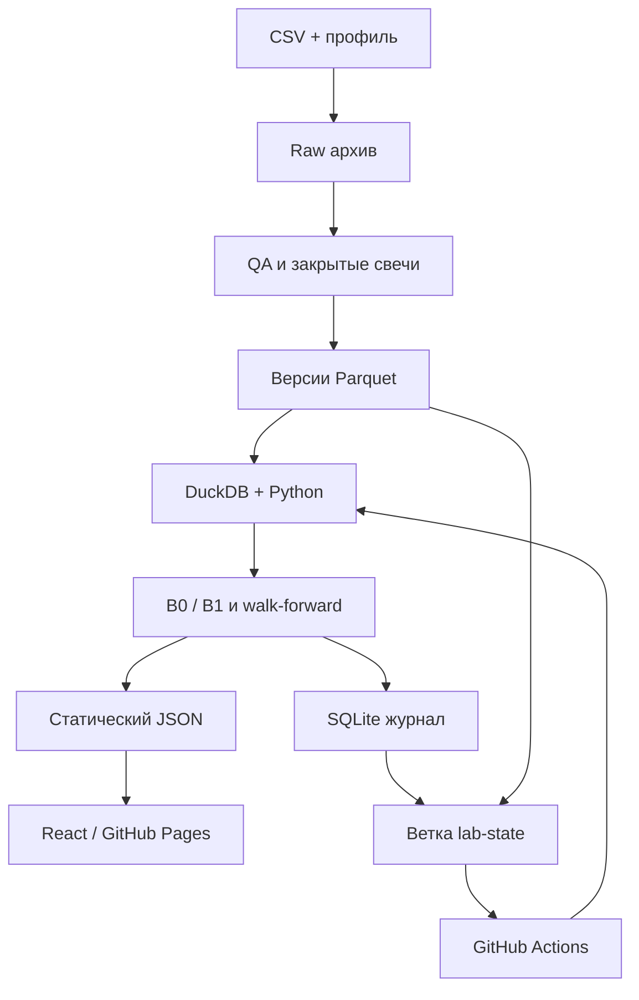

# Архитектура v0.1

`main` хранит код, настройки, документацию и сознательно опубликованные входные файлы. `lab-state` хранит raw CSV, профили импорта, версии Parquet и SQLite. Состояние не зависит от cache или срока хранения artifacts. Артефакт Actions — дополнительная 14-дневная аварийная копия.

Рабочий каталог очередного runner временный. `scripts/state.py restore` создаёт отдельный worktree предыдущего состояния; `save` делает обычный fast-forward push без force. Одновременные research runs сериализованы. Если восстановление/сохранение состояния не удалось, публикация останавливается.

В Pages публикуется только `frontend/dist`. Там нет сервера Python, токенов и SQLite. Браузер читает JSON предыдущего расчёта. Импорт CSV на Pages — локальный preview; полноценный импорт работает через CLI или локальный FastAPI.

Локальный режим сохраняет `data/`, API слушает только loopback через стартовые скрипты. CI не изменяет production модели. Реальных ордеров и broker endpoints нет.

Завершение 24/7 feed и webhook — отдельный этап с постоянным Linux-процессом, очередью, проверкой источника и аутентификацией UI. Архитектура не выдаёт периодический batch за этот процесс.
